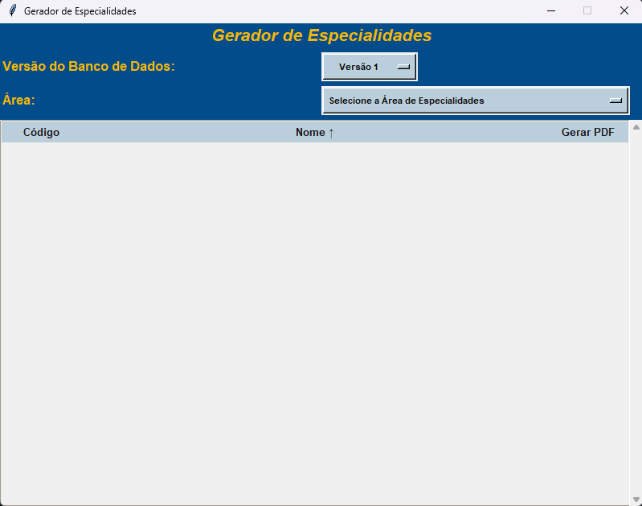
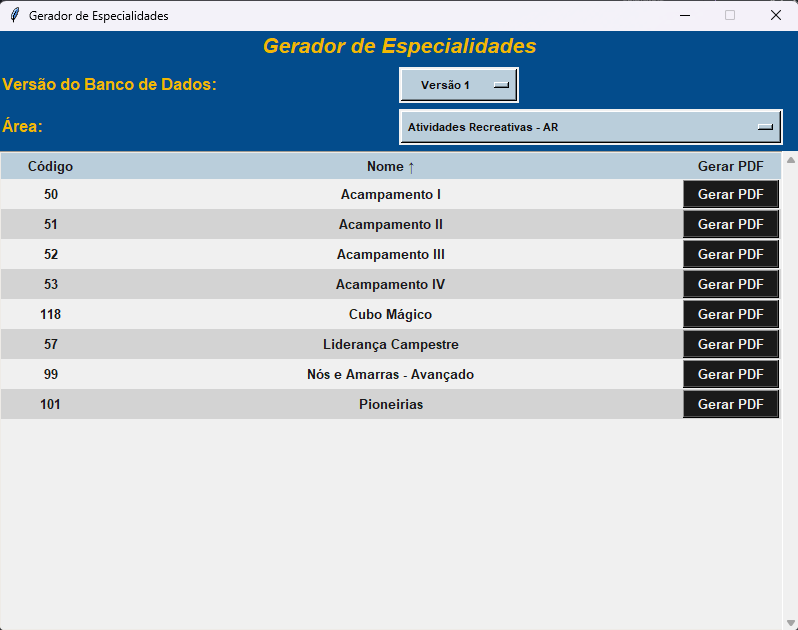
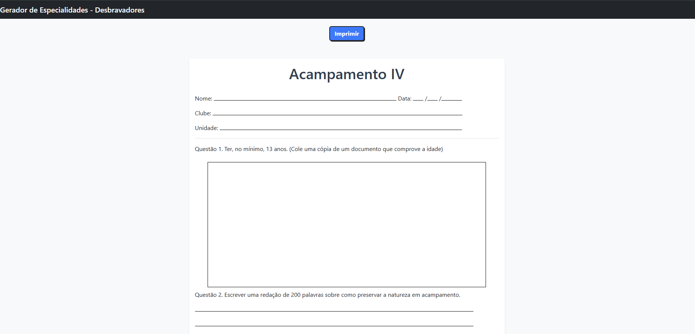

# 📚 Guia do Usuário - Gerador de Especialidades

## Bem-vindo!

O **Gerador de Especialidades** é uma aplicação que permite consultar, visualizar e gerar documentos em PDF com as especialidades dos desbravadores.

---

## 🚀 Como Iniciar

### Passo 1: Executar a Aplicação

1. **No Windows**: Clique duas vezes no arquivo `inicializar.bat`
2. **Via linha de comando**: Na pasta do projeto, execute:
   ```
   python main.py
   ```

A janela da aplicação abrirá automaticamente.

---

## 🎯 Interface Principal

A tela principal é dividida em duas seções:



### Seção Superior (Opções)
Aqui você configura qual especialidade deseja consultar.

### Seção Inferior (Lista de Especialidades)
Exibe todas as especialidades da área selecionada com opções para gerar PDFs.

---

## 📋 Passo a Passo: Como Gerar uma Especialidade

### 1️⃣ Selecione a Versão do Banco de Dados

Na seção superior, encontre **"Versão do Banco de Dados"**.

- Clique no menu suspenso
- Escolha a versão desejada
- A lista de especialidades será atualizada automaticamente

> **Dica**: A versão refere-se à data ou período de atualização dos dados de especialidades.

### 2️⃣ Selecione a Área de Especialidades

Abaixo de "Versão do Banco de Dados", encontre **"Área"**.

- Clique no menu suspenso
- Procure pela área desejada (aparece no formato "Nome da Área - Código")
- Clique para selecionar

A lista de especialidades será carregada automaticamente.

> **Exemplo**: "Estudos da Natureza - EN" ou "Atividades Recreativas - AR"



### 3️⃣ Visualize a Lista de Especialidades

A lista exibe todas as especialidades da área selecionada com três colunas:

| Coluna | Descrição |
|--------|-----------|
| **Código** | Identificador único da especialidade |
| **Nome** | Nome completo da especialidade |
| **Gerar PDF** | Botão para gerar o documento |

### 4️⃣ Ordene as Especialidades (Opcional)

Você pode ordenar a lista de duas formas:

**Por Código:**
- Clique no cabeçalho "Código"
- A primeira vez ordena de forma crescente (↑)
- A segunda vez ordena de forma decrescente (↓)

**Por Nome:**
- Clique no cabeçalho "Nome"
- A primeira vez ordena de forma crescente (↑)
- A segunda vez ordena de forma decrescente (↓)

> **Indicador Visual**: Um símbolo (↑ ou ↓) aparece no cabeçalho mostrando a ordem atual.

### 5️⃣ Gere o PDF da Especialidade

Para cada especialidade, há um botão **"Gerar PDF"** na última coluna.

1. **Encontre a especialidade desejada** na lista
2. **Clique no botão "Gerar PDF"** correspondente à especialidade
3. **O documento será criado** e poderá estar disponível para download ou abertura automática

> **O botão muda de cor ao passar o mouse** para indicar que é clicável.

Será aberto o navegador padrão do usuário com uma página ***html*** da especialidade gerada. Há um botão para poder imprimir a especialidade.




---

## 💡 Dicas Úteis

### Navegação
- 🖱️ **Rolar para cima/baixo**: Use a roda do mouse para navegar pela lista se houver muitas especialidades
- ⌨️ **Teclado**: Às vezes você pode usar Tab para navegar entre elementos

### Botões
- Os botões **"Gerar PDF" ficam destacados** quando você passa o mouse sobre eles
- Um cursor em forma de "mão" aparece para indicar que é um elemento clicável

### Seleção de Áreas
- Se não vir a área desejada, certifique-se de ter selecionado a **versão correta** do banco de dados
- Diferentes versões podem ter diferentes conjuntos de áreas disponíveis

---

## 📄 Sobre os PDFs Gerados

Cada PDF contém:
- ✅ Informações completas da especialidade
- ✅ Requisitos e objetivos
- ✅ Dados formatados e organizados

Ao imprimir o pdf você deve escolher o local no computador onde será salvo e dar um nome ao arquivo.

---

## ❓ Dúvidas Frequentes


**P: Quantas especialidades posso visualizar?**  
R: Você pode visualizar todas as especialidades da área selecionada. Não há limite, basta rolar pela lista.

**P: Posso gerar PDFs de todas as especialidades de uma vez?**  
R: Não, você precisa clicar em cada botão "Gerar PDF" individualmente. No entanto, o processo é rápido.

**P: Onde os PDFs são salvos?**  
R: A localização depende das configurações do seu computador. Geralmente, são salvos na pasta de Downloads ou na pasta do projeto.

**P: Posso usar versões antigas do banco de dados?**  
R: Sim! O menu suspenso "Versão do Banco de Dados" permite escolher qualquer versão anterior.

**P: A lista de especialidades está vazia. O que fazer?**  
R: Verifique se você selecionou corretamente:
1. A **versão do banco de dados**
2. A **área de especialidades**

Se nada aparecer, tente reiniciar a aplicação. Caso nada funcione, entre em contato com o desenvolvedor do projeto.

**P: Como saber se a minha versão do banco de dados está atualizada?**

R: Verifique no repositório do GitHub do projeto se há alguma versão superior a que está salva na sua aplicação.
A base de dados é salva na pasta ***/data*** na pasta raíz da aplicação. Cada versão está em uma pasta própria, identificada pelo número da versão. Ex: ***/v1***, ***/v2***

Acesse o repositório na pasta ***/data*** ([link da pasta /data no repositório](https://github.com/Wanderson-Patricio/gerador-de-trabalhos-especialidades-desbravadores/tree/main/data)) e verifique se há alguma versão maior que as que estão indicadas no seu projeto.

---

## 📞 Precisa de Ajuda?

Se encontrar algum problema ou tiver sugestões, consulte a documentação técnica do projeto ou entre em contato com o desenvolvedor.

### [Enviar email](mailto:wanderfapat@gmail.com)
### [Link do Repositório GitHub](https://github.com/Wanderson-Patricio/gerador-de-trabalhos-especialidades-desbravadores)

---

**Aproveite o Gerador de Especialidades! 🎉**
